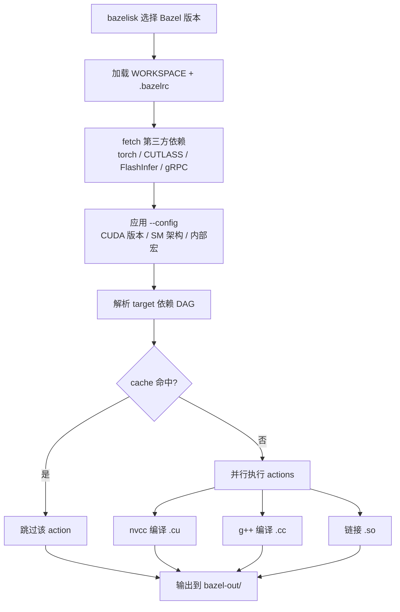

# Bazelisk Build 流程说明（RTP-LLM）

本文说明在 RTP-LLM 仓库中执行 `bazelisk build` 时，Bazel 实际做了哪些事情。适用于本地开发、CI 编译，以及理解 `libth_transformer.so` 等产物的生成过程。

> **工作目录**：所有 build 命令均应在 `github-opensource/` 下执行，而非 monorepo 根目录。

---

## 1. Bazelisk 的角色

`bazelisk` 不是编译器，而是 **Bazel 版本管理器**：

1. 读取 `.bazelversion`（或环境变量）确定应使用的 Bazel 版本
2. 按需下载对应版本的 `bazel` 可执行文件
3. 将 `build` 子命令及参数转发给 Bazel

因此：

```bash
bazelisk build //:th_transformer --config=cuda13
```

等价于「用项目锁定的 Bazel 版本，编译 `//:th_transformer` 这个 target」。

---

## 2. 整体流程概览



---

## 3. 加载工程与依赖（WORKSPACE 阶段）

Bazel 首先解析 `WORKSPACE` 和 `.bazelrc`，完成工具链探测与外部依赖拉取。

### 3.1 工具链配置

| 组件 | 配置来源 | 典型路径 |
|------|----------|----------|
| CUDA | `cuda_configure` | `/usr/local/cuda/` |
| ROCm | `rocm_configure` | `/opt/rocm/` |
| Python | `python_configure` | `/opt/conda310/bin/python3` |

### 3.2 外部依赖

通过 `deps/http.bzl`、`deps/git.bzl` 等拉取：

- PyTorch wheel（按平台区分：cuda12 / cuda12_9 / cuda13 / rocm / ppu / arm）
- CUTLASS、FlashInfer、DeepGEMM
- gRPC、protobuf、havenask（autil 等）
- xgrammar 等 git 子模块

### 3.3 内部 overlay

`.bazelrc` 末尾通过 `try-import` 加载内部配置：

```bash
try-import %workspace%/stub_source/.internal_bazelrc
try-import %workspace%/internal_source/.cicd_bazelrc
```

`stub_source` **必须指向 `internal_source`**，否则内部宏（RDMA、DeepEP、PPU 等）和内部代码路径不可用，build 可能挂起或缺少功能。

首次 build 或依赖变更时，此阶段较慢；之后大多命中 Bazel cache。

---

## 4. 编译配置（`.bazelrc` + `--config`）

### 4.1 全局默认选项

| 选项 | 含义 |
|------|------|
| `--python_top=//:python310` | 固定使用 `/opt/conda310/bin/python3` |
| `--spawn_strategy=local` | 本地 spawn，避免 nvcc 并发冲突 |
| `-c opt` + `-O2` + `-g` | 优化编译，保留调试符号 |
| `-Wall -Werror` | 开启警告并视为错误 |
| `-std=c++17` | C++17 标准 |
| `--experimental_cc_shared_library` | 启用 cc_shared_library 实验特性 |

### 4.2 平台 config 对照

| Config | 平台 | CUDA 版本 | 计算能力 (SM) | 备注 |
|--------|------|-----------|---------------|------|
| `cuda12` | NVIDIA x86 | 12.4 | 7.0–9.0 | 默认 GPU build |
| `cuda12_6` | NVIDIA x86 | 12.6 | 7.0–9.0 | CXX11 ABI |
| `cuda12_9` | NVIDIA x86 | 12.9 | 7.0–10.0 | 支持 FP4 |
| `cuda13` / `cuda13_arm` | NVIDIA | 13.x | 10.0+ | GB200 / B300 等 |
| `rocm` | AMD MI300X | — | gfx942 | HIP 编译 |
| `ppu` | 内部 PPU | 12.3 | — | Triton 启用 |
| `cpu` / `arm` | CPU | — | — | 无 GPU |

可叠加 SM 限定 config 缩短编译时间：

| SM Config | 计算能力 | 典型 GPU |
|-----------|----------|----------|
| `sm7x` | 7.0, 7.5 | V100, T4 |
| `sm8x` | 8.0, 8.6, 8.9 | A100, 3090, L40 |
| `sm9x` | 9.0 | H800, H100 |
| `sm10x` | 10.0 | GB200 |

示例：

```bash
bazelisk build //:th_transformer --config=cuda12_6 --config=sm8x
```

### 4.3 `--config` 决定的条件编译

`--config` 会通过 `-D` 宏和 `define` 开关选择代码路径，例如：

- `USING_CUDA=1`、`USING_CUDA12=1`、`USING_CUDA12_9=1`
- `ENABLE_BF16=1`、`ENABLE_FP8=1`、`ENABLE_FP4=1`
- `BUILD_CUTLASS_MIXED_GEMM=ON`
- 内部：`USE_RDMA=1`、`ENABLE_DEEP_EP=1`（来自 `.internal_bazelrc`）

---

## 5. Target 依赖图与主要产物

### 5.1 核心 shared library targets

定义于根目录 `BUILD`：

| Target | 输出文件 | 用途 |
|--------|----------|------|
| `//:th_transformer_config` | `libth_transformer_config.so` | 配置类型 pybind，Python 最先加载 |
| `//:rtp_compute_ops` | `librtp_compute_ops.so` | Python 模型执行路径的 compute ops |
| `//:th_transformer` | `libth_transformer.so` | 完整 C++ 推理引擎（RtpLLMOp） |

其他常见 target：

| Target | 产出 |
|--------|------|
| `//rtp_llm:rtp_llm` | Python 包相关产物 |
| `//rtp_llm:rtp_llm_wheel` | 可 pip 安装的 wheel |

### 5.2 `libth_transformer.so` 依赖链（简化）

```
libth_transformer.so
└── rtp_llm/cpp/pybind:th_transformer_lib
    ├── normal_engine/      调度、KV cache、CUDA graph、投机解码
    ├── cache/              PagedAttention、MHA/MLA、prefix caching
    ├── cuda/               CUTLASS、FlashInfer、cuBLAS、DeepGEMM
    ├── models/             权重加载、采样、MoE/EPLB
    ├── model_rpc/          gRPC 分布式 prefill/decode
    └── api_server/         C++ HTTP OpenAI 兼容接口
```

### 5.3 `librtp_compute_ops.so` 额外链接

```
librtp_compute_ops.so
└── rtp_llm/cpp/pybind:th_compute_lib
    ├── models_py/bindings/cuda/ops/   Python 侧 GPU ops
    ├── models_py/bindings/cuda/kernels/ Triton/CUDA kernel bindings
    └── cache/、distribute/ 等 C++ 模块
```

`th_transformer` 在链接时会引用 `rtp_compute_ops`，因此两者 `--config` 应保持一致。

---

## 6. 编译 Actions 详解

Bazel 将依赖图拆分为大量 **action**，按 `--jobs` 并行执行。RTP-LLM 全量 build 约 **26000+ actions**，首次耗时 **30 分钟～2 小时**（视 GPU 和并行度而定）。

### 6.1 C++ 编译（g++）

- 引擎核心：`NormalEngine`、`KVCacheManager`、Scheduler 等
- pybind11 绑定：`ConfigInit.cc`、`ComputeInit.cc` 等
- gRPC / protobuf 生成代码

### 6.2 CUDA 编译（nvcc）— 通常最慢

- FlashAttention / FlashInfer 算子
- CUTLASS 混合精度 GEMM（FP8/FP4、MoE）
- 自定义 kernel：量化、RoPE、scatter、MoE routing 等
- 每个 `.cu` 可能为多个 SM 架构各编译一份（由 `TF_CUDA_COMPUTE_CAPABILITIES` 决定）

### 6.3 链接（ld）

- 静态库 / 目标文件 → 共享库 `.so`
- 设置 `-Wl,-rpath='$$ORIGIN'`，保证运行时找到依赖

### 6.4 其他 action

- `genrule`：从 RPM 提取库、生成版本号等
- Python wheel 打包（target 为 `rtp_llm_wheel` 时）
- proto 代码生成

### 6.5 增量 build

仅重编**变更文件及其下游依赖**；未变化的 action 直接命中本地或远程 cache。修改单个 `.cu` 通常只需重编该文件并重链接相关 `.so`（几十秒到数分钟）。

---

## 7. 产出物路径

默认输出目录：

```
bazel-out/k8-opt/bin/
├── libth_transformer_config.so
├── librtp_compute_ops.so
├── libth_transformer.so
└── rtp_llm/...
```

Python 运行时通过 `rtp_llm/ops/` 中的 loader 动态加载上述 `.so`。

可通过 symlink 或 `bazel run` 将产物 materialize 到源码树供本地脚本直接使用。

---

## 8. 常用 build 命令

### 8.1 本地开发（完整引擎）

```bash
cd github-opensource

bazelisk --batch build \
  //:th_transformer //:rtp_compute_ops //:th_transformer_config \
  --config=cuda13 \
  --verbose_failures \
  --jobs=$(nproc)
```

### 8.2 仅 Python compute ops（如 sparse MLA demo）

```bash
cd github-opensource

bazelisk build //:rtp_compute_ops --config=cuda13
bazelisk build //:th_transformer --config=cuda13   # 保持 config 一致
```

### 8.3 构建 wheel

```bash
bazelisk build //rtp_llm:rtp_llm_wheel --config=cuda12_6
```

### 8.4 指定 output root（多 worktree 隔离）

```bash
bazelisk --output_user_root=/path/to/bazel_output \
  --batch build //:th_transformer --config=cuda12_9
```

> `--output_user_root` 路径必须与工作目录在同一路径体系下，否则可能出现 `dangling symbolic link` 错误。

---

## 9. `bazel build` vs `bazel test`

| | `bazel build` | `bazel test` |
|---|---------------|--------------|
| 目的 | 只编译产出物 | 编译 + 运行测试 |
| 产出 | `.so`、wheel、binary | 同上 + test log |
| CI 对应 | `basic_test.sh` build stage | test stage（常带 remote executor + GPU lock） |

Smoke test 会先 build `//internal_source/rtp_llm/test/smoke:xxx` 及其全部依赖（含三个核心 `.so`），再执行 Python 测试脚本做 golden 对比。

---

## 10. 注意事项与常见问题

### 10.1 前置检查

```bash
# 确认 stub_source 指向 internal_source
ls -la github-opensource/stub_source

# 若错误，修复：
cd github-opensource
ln -snf $(cd .. && pwd)/internal_source stub_source
```

### 10.2 常见错误

| 错误 | 原因 | 处理 |
|------|------|------|
| `dangling symbolic link` | `--output_user_root` 与工作目录路径体系不一致 | 使用一致的绝对路径，`bazelisk clean` 后重试 |
| `undeclared inclusion of header` | BUILD 缺少 dep | 在对应 BUILD 中添加依赖 |
| import `.so` 报 CUDA / FlashInfer 符号缺失 | `.so` 与当前 CUDA 环境不匹配 | 用正确的 `--config` 重新 build |
| bazel 挂起 | `stub_source → open_source` | 修复 symlink 指向 `internal_source` |

### 10.3 监控 build 进度

```bash
tail -5 <output_user_root>/<hash>/command.log
```

### 10.4 关键设计选择

- **`--spawn_strategy=local`**：避免多个 nvcc 进程冲突，GPU kernel 编译基本在本地执行
- **`-c opt -O2 -g`**：生产级优化 + 保留调试符号，便于 coredump 分析
- **多 SM 编译**：默认 config 可能为多个架构各生成一份 SASS，可通过 `sm8x` 等缩小范围加速迭代

---

## 11. 相关文档

- [Install RTP-LLM](./install.md) — 安装与 wheel 构建入门
- [Environment](../references/Environment.md) — 运行环境要求
- [Contributing](../references/Contributing.md) — 贡献与 CI 说明
- 本地编译详细步骤：monorepo 内 `internal_source/.claude/skills/local-build-and-serve/SKILL.md`
